# Win32 window transparency

How to get a window on Windows 10/11 whose client area is transparent per pixel, so that what you draw blends with whatever is behind the window. And why the usual recipes fail in such confusing ways. Every claim on this page comes with a small demo program and a screenshot of what it does on my machine.

I wrote this up because the information is spread over Microsoft docs that are partly from the Windows 7 days, forum posts from the same time, and bug reports (GLFW alone has several). Some of it only makes sense once you look at what actually ends up in the window's pixels, so that's what the demos do.

## The rules

If you just want it to work:

1. Opt in to alpha compositing with `DwmEnableBlurBehindWindow`, using `DWM_BB_ENABLE | DWM_BB_BLURREGION` and the region `CreateRectRgn(0, 0, -1, -1)`, which is a single pixel just outside the client area. Without this call DWM ignores the alpha byte of the window's own surface, and that's where GDI and every present path that copies into the window write. Don't pass a NULL or an empty region (both darken what's behind the window), and don't use `DwmExtendFrameIntoClientArea` instead (it puts the opaque frame material behind your client area).
2. Make sure the window's own surface is transparent: give the window class a black background brush, the stock `BLACK_BRUSH` or any solid `RGB(0, 0, 0)` brush. A black solid fill sets all four bytes of a pixel to 0. `DefWindowProc` erases with that brush when it handles `WM_ERASEBKGND`, so if your window procedure returns TRUE for that message (GLFW's does), clear in `WM_PAINT` instead, with `PatBlt(BLACKNESS)`. Any other color gets added on top of the background, and a window that never paints its client area can stay opaque white.
3. Write premultiplied alpha. DWM computes `window color + background * (1 - window alpha)`, so 50% red is `(0.5, 0, 0, 0.5)` and not `(1, 0, 0, 0.5)`.
4. With Direct3D, use a composition swapchain (`CreateSwapChainForComposition` with `DXGI_ALPHA_MODE_PREMULTIPLIED`) as the content of a DirectComposition visual. A flip-model swapchain from `CreateSwapChainForHwnd` is always opaque. Rules 1 and 2 still apply, the visual is drawn on top of the window's surface.
5. With Vulkan, use `VK_COMPOSITE_ALPHA_PRE_MULTIPLIED_BIT_KHR` if the surface capabilities offer it, and still do 1 and 2.
6. With OpenGL, choose a pixel format with alpha bits, and also give the window `WS_EX_LAYERED` with `SetLayeredWindowAttributes(hwnd, 0, 255, LWA_ALPHA)`. Drivers can present OpenGL through a DXGI swapchain, and then you only get transparency with the layered style.
7. Don't use `WS_EX_NOREDIRECTIONBITMAP`, unless every bit of content in that window comes from your own DirectComposition visuals. Anything that presents by copying into the window's surface shows nothing at all without one.

The window setup from rules 1 and 2, as in `05_perpixel_alpha.cpp`:

```cpp
wc.hbrBackground = (HBRUSH) GetStockObject(BLACK_BRUSH);
RegisterClass(&wc);
// ... CreateWindowEx, and leave WM_ERASEBKGND to DefWindowProc ...

// One pixel at (-1, -1), outside the client area. A NULL or empty region darkens.
HRGN region = CreateRectRgn(0, 0, -1, -1);
DWM_BLURBEHIND bb = {};
bb.dwFlags = DWM_BB_ENABLE | DWM_BB_BLURREGION;
bb.fEnable = TRUE;
bb.hRgnBlur = region;
DwmEnableBlurBehindWindow(hwnd, &bb);
DeleteObject(region);
```

Everything below is the detail: what each rule is based on, with demos and screenshots, and where Microsoft's documentation helps or misleads. You only need it if you want to know why, or if something still doesn't work. In that case [When it doesn't work](#when-it-doesnt-work) is probably the quickest way in.

## Contents

* [The demos](#the-demos)
* [Not per-pixel transparency](#not-per-pixel-transparency)
* [The redirection surface and the DWM opt-in](#the-redirection-surface-and-the-dwm-opt-in)
* [What writes the alpha channel](#what-writes-the-alpha-channel): [GDI](#gdi), [clearing in WM_PAINT](#clearing-in-wm_paint), [nothing paints](#nothing-paints), [GLFW](#glfw)
* [Premultiplied alpha](#premultiplied-alpha)
* [GPU content (DXGI)](#gpu-content-dxgi): [composition swapchain](#composition-swapchain), [flip model](#flip-model-hwnd-swapchain), [bitblt model](#bitblt-model-hwnd-swapchain), [why not WS_EX_NOREDIRECTIONBITMAP](#why-not-ws_ex_noredirectionbitmap)
* [Vulkan](#vulkan)
* [OpenGL](#opengl)
* [When it doesn't work](#when-it-doesnt-work)
* [Microsoft documentation](#microsoft-documentation)

## The demos

Each demo is a small program on its own, most of them not much more than a window procedure. They all put a gray checkerboard (85 and 170 gray, 16 pixel squares) right behind the demo window, so you see immediately what's transparent, and the screenshots always have the same known background instead of my desktop. The checkerboard doesn't follow the window. Move the window away and you see your desktop again. Escape closes every demo.

`capture_screenshots.ps1` runs all demos, including their command line variants, and saves the screenshots into `screenshots/`, together with the console output of the demos that print something. The pixel values on this page are read from these screenshots, the surface bytes from the console output.

For completeness, the screenshots are from Windows 11 (build 26200) at 100% scaling, with an NVIDIA RTX 3060 Ti and driver 610.47. The capture script writes these details into `screenshots/capture-info.txt`. I've only tested on Windows 11. Most of this doesn't depend on the GPU at all, it's decided by Windows (GDI, DWM, DXGI). The exception is how a driver presents Vulkan and OpenGL, and the [Vulkan](#vulkan) and [OpenGL](#opengl) sections say what's driver-specific. If you get different results on other hardware or another Windows version, please open an issue.

To build you need CMake 3.20+, a C++17 compiler and the Windows SDK 10.0.22621 or newer (`03` uses the Windows 11 backdrop API). GLFW 3.4 is fetched automatically. The Vulkan demo needs the Vulkan SDK and is skipped without it.

```sh
cmake -S . -B build
cmake --build build --config Release
powershell -ExecutionPolicy Bypass -File capture_screenshots.ps1
```

## Not per-pixel transparency

A lot of window options sound like transparency, but none of these four gives you per-pixel alpha. All of them paint the client area with a red class brush.

| `01_basic_opaque` | `02_popup_no_decorations` | `03_win11_backdrop` | `04_layered_uniform_alpha` |
|---|---|---|---|
| 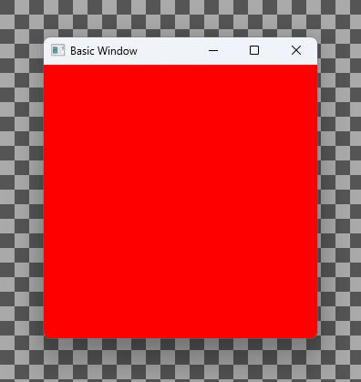 | 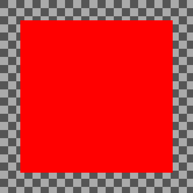 | 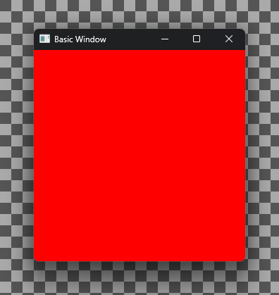 | 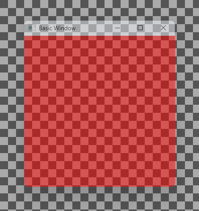 |

`01` is a normal window. `02` is the same with `WS_POPUP`, so no title bar and no border, but the client area is just as opaque. Decorations and transparency are independent of each other. `03` gives the frame the Windows 11 Mica backdrop and dark mode with `DwmSetWindowAttribute`. The client area stays as opaque as in `01`.

`04` is `WS_EX_LAYERED` with `SetLayeredWindowAttributes(hwnd, 0, 128, LWA_ALPHA)`: the whole window, title bar included, at one opacity. That's useful for fading a window in and out. Layered windows can also do per-pixel alpha with `UpdateLayeredWindow`, where you hand Windows a complete 32-bit bitmap for every update. That's a different way of drawing altogether and not covered here.

## The redirection surface and the DWM opt-in

Since Windows 8 everything on the desktop goes through DWM, the desktop window manager (on Vista/7 you could turn it off). Every top-level window gets a redirection surface, a bitmap with 32 bits per pixel, BGRA. GDI draws into it, and DWM composes it onto the screen. Graphics APIs either copy their frames into it or put them on top of it, more on that [later](#gpu-content-dxgi).

DWM treats this surface as opaque, whatever is in the alpha byte, unless you opt in. The opt-in is `DwmEnableBlurBehindWindow`. The name and the documentation are about blur, which was a Vista/7 feature. On Windows 10/11 nothing gets blurred anymore, but the call still turns on per-pixel alpha for the client area, and that's what GLFW and others use it for.

`05_perpixel_alpha` is the minimal setup that works, a black background brush plus the call from [the rules](#the-rules):


`06_dwm_opt_in` puts a 50% red square into the same window (premultiplied, copied from a 32-bit bitmap, see [GDI](#gdi)) and opts in four different ways:

| `--blur` | `--blur-null` | `--extend-frame` | `--none` |
|---|---|---|---|
| 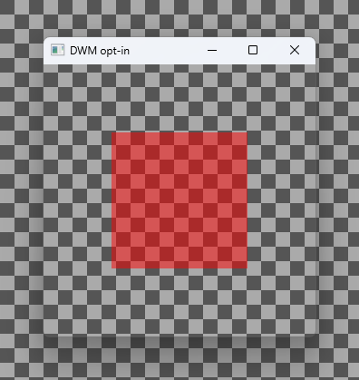 | 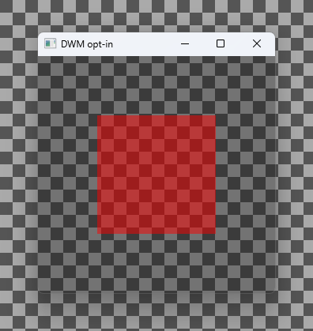 | 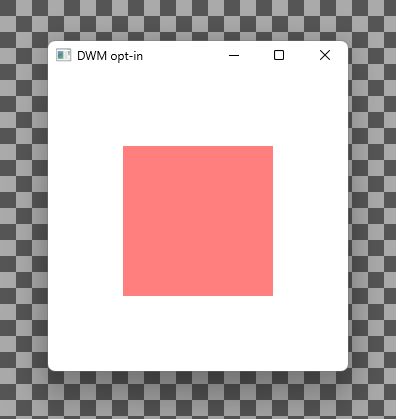 | 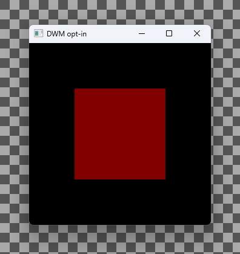 |

With the region from `05` (`--blur`) the result is exact. The client area shows the checkerboard unchanged, and the square is `128 + background / 2` red: 170,42,42 over the dark squares and 213,85,85 over the light ones. `CreateRectRgn(0, 0, -1, -1)` looks like an empty region, but GDI swaps the coordinates, so it's the one pixel at (-1, -1). That's outside the client area, and the blur applies nowhere.

The [`DWM_BLURBEHIND`](https://learn.microsoft.com/en-us/windows/win32/api/dwmapi/ns-dwmapi-dwm_blurbehind) documentation says a NULL region (`--blur-null`) "will apply the blur behind the entire client area". On Windows 11 that "blur" is a darkening layer under the window. The checkerboard comes through at about 70% (85 becomes 59, 170 becomes 115), and the content is blended over that. On a dark desktop you might not even notice. A really empty region, `CreateRectRgn(0, 0, 0, 0)` with `--blur-empty`, gives exactly the same pixels as NULL (not shown). So what you want is a region that isn't empty but lies outside the client area, and the pixel at (-1, -1) is what GLFW uses too.

`DwmExtendFrameIntoClientArea` with -1 margins shows up in a lot of transparency recipes. Those are from Windows 7, where the frame was glass and you could see through it. Today the client area shows the frame material, opaque white here, and the square blends over that (255,127,127). The [documentation](https://learn.microsoft.com/en-us/windows/win32/api/dwmapi/nf-dwmapi-dwmextendframeintoclientarea) actually only promises "a solid surface with no window border", which is pretty much what you get.

And without any opt-in DWM ignores the alpha byte of the surface, so black stays black and the square is plain dark red (128,0,0).

## What writes the alpha channel

The opt-in makes DWM look at the alpha byte. What's in that byte is a separate question, and the answer surprised me a bit.

### GDI

GDI takes colors as `COLORREF`, which is RGB without alpha. So it's tempting to think you can't control alpha with GDI, and that a black brush just paints opaque black. But the redirection surface has 32 bits per pixel, and GDI writes all of them.

`07_gdi_alpha` measures that. It first makes nine cells opaque white with `PatBlt(WHITENESS)`, which sets all 32 bits, and then does one GDI operation per cell. It reads the surface back through the window DC (that gives you the bytes, alpha included) and the screen through the screen DC (that gives you what DWM composed). The white fill first matters: what a surface starts out with varies (see [nothing paints](#nothing-paints)), and on a zeroed one every operation would look transparent.

```
                                     before    after     behind       on screen
nothing                              FFFFFFFF  FFFFFFFF   85, 85, 85  255,255,255
FillRect, stock BLACK_BRUSH          FFFFFFFF  00000000   85, 85, 85   85, 85, 85
FillRect, RGB(0, 0, 0) brush         FFFFFFFF  00000000   85, 85, 85   85, 85, 85
PatBlt(BLACKNESS)                    FFFFFFFF  00000000   85, 85, 85   85, 85, 85
BLACK_BRUSH class brush erase        FFFFFFFF  00000000   85, 85, 85   85, 85, 85
FillRect, RGB(128, 128, 128) brush   FFFFFFFF  00808080   85, 85, 85  213,213,213
FillRect, COLOR_WINDOW + 1           FFFFFFFF  00FFFFFF   85, 85, 85  255,255,255
BitBlt, 32bpp DIB 0x80800000         FFFFFFFF  80800000   85, 85, 85  170, 42, 42
FillRect, 32bpp DIB pattern brush    FFFFFFFF  80800000   85, 85, 85  170, 42, 42
```

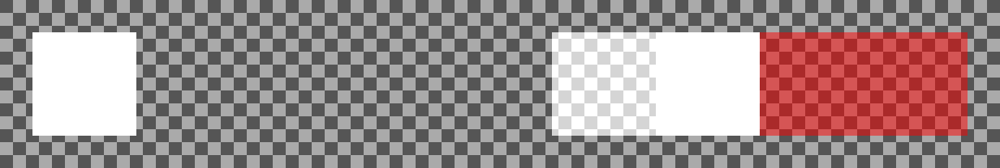

Fills with a solid brush, including the class brush erase that `DefWindowProc` does, write the color with alpha 0. Black becomes `00000000`, which is fully transparent, and it doesn't matter whether it's the stock `BLACK_BRUSH` or a brush you created. Every other color gets added to the background, because DWM composes premultiplied: gray over 85 gives 85 + 128 = 213. White saturates and looks opaque, but its alpha is 0 too.

The constant raster operations `BLACKNESS` and `WHITENESS` set all 32 bits, so `WHITENESS` gives you a really opaque `FFFFFFFF`. And `BitBlt` from a 32-bit DIB copies all 32 bits, alpha included. That's how you get any alpha you want into the surface with GDI: write premultiplied pixels into a DIB section and `BitBlt(SRCCOPY)` them. A pattern brush made from such a DIB with `CreateDIBPatternBrushPt` keeps the alpha as well, that's the last cell. None of these operations leaves the alpha byte alone, and black is special only because it's the one color where "alpha 0" also means transparent.

With `--no-blur` the bytes are the same, DWM just ignores alpha (the black cells are black, the two DIB cells are 128,0,0). With `--layered`, `WS_EX_LAYERED` at alpha 255, everything is the same as without it.

Microsoft's [Custom Window Frame Using DWM](https://learn.microsoft.com/en-us/windows/win32/dwm/customframe) gets the black brush right. It says the black border has "pixel data in which all color values (red, green, blue, and alpha) are set to 0", and calls setting `hbrBackground` to the stock `BLACK_BRUSH` the easiest way to get there. The same paragraph says the default `COLOR_WINDOW + 1` background "does not have the alpha value set to 0". It does: the seventh cell fills with exactly that brush and gets `00FFFFFF`. It only looks opaque because white plus anything is white. I think the sentence describes what you see and not what's in the bytes. Read literally, it's wrong. The same page uses the DIB route for its caption text, `DrawThemeTextEx` into a 32-bit DIB and then `BitBlt`.

### Clearing in WM_PAINT

`08_perpixel_alpha_patblt` is the alternative to the black brush: a NULL brush, `WM_ERASEBKGND` returns 1, and `WM_PAINT` clears the invalid rectangle with `PatBlt(BLACKNESS)`. The result is the same as `05`. You need this when your window procedure handles `WM_ERASEBKGND` itself, so `DefWindowProc` never erases with the class brush, or when the class brush isn't yours to choose (GLFW, for example, uses one window class for all its windows). It also lets you control when the clear happens.

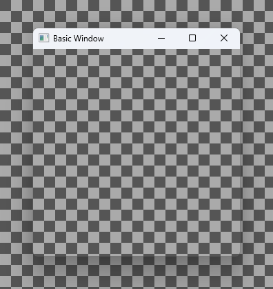

### Nothing paints

If nothing ever paints the client area, you see whatever the surface started out with, and that depends on the window. `09_nothing_paints` does what GLFW does for a transparent framebuffer: NULL brush, `WM_ERASEBKGND` returns TRUE, nothing paints, and blur-behind as in `05`. It prints the surface bytes in the middle of the client area. Then it swaps the two colors of the checkerboard, so you can tell a window that shows what's behind it from one that shows a copy of it.

| `09_nothing_paints` | `--popup` | `--popup --layered` |
|---|---|---|
| 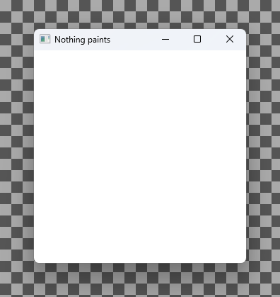 | 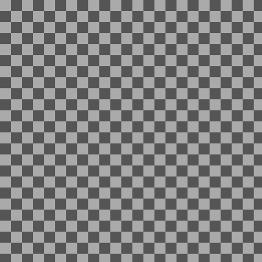 | 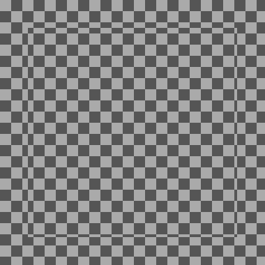 |

As a normal window with a title bar, the client area is opaque white, and it's really opaque: the surface reads back as `FFFFFFFF`.

With `WS_POPUP` the window looks transparent, but DWM just doesn't draw it at all. The checkerboard swapped its colors as if the window wasn't there. Its surface reads back as `FF555555`: the dark checkerboard square, opaque, because the surface holds a copy of what was on the screen there. With `WS_EX_LAYERED` DWM does draw the window, and then you see that copy: inside the window the squares didn't swap. So a quick test with a borderless window can make you think everything's fine, and the same code shows opaque white in a window with a title bar. I've only checked this on Windows 11 and wouldn't rely on any of it.

A black class brush doesn't help here (`--black-brush`, looks like the first screenshot). `DefWindowProc` would erase with it, but this window procedure returns TRUE for `WM_ERASEBKGND`, so the surface stays `FFFFFFFF`. `WS_EX_LAYERED` on the normal window (`--layered`) changes the surface to `00FFFFFF`. That's alpha 0, but white looks opaque whatever its alpha (see [GDI](#gdi)), so that looks the same too.

### GLFW

`10_glfw_transparency_bug` is a GLFW 3.4 window with `GLFW_TRANSPARENT_FRAMEBUFFER` and no rendering at all. GLFW opts in with blur-behind (correctly, with the region from `05`) but leaves the surface as it is, so you get the opaque white from `09`. Its surface also reads back as `FFFFFFFF`.

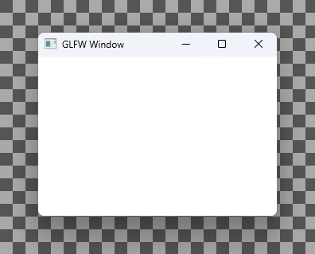

When you render into such a window with OpenGL or Vulkan, what you see depends on how the driver presents. If your frames end up in a composition swapchain on top of the surface (see [below](#composition-swapchain)), your translucent pixels are blended over opaque white. The [glfw_repro1](https://github.com/jeweg/glfw_repro1) repository has a repro with actual rendering.

As of November 2026 there are open pull requests for this. My [#2815](https://github.com/glfw/glfw/pull/2815) clears the surface in `WM_PAINT` like `08`, and my [#2925](https://github.com/glfw/glfw/pull/2925) makes transparent framebuffer windows layered (see [OpenGL](#opengl) for why). The older [#2681](https://github.com/glfw/glfw/pull/2681) makes the window layered too, and gives it a black class brush. That brush doesn't clear the surface, though: GLFW's window procedure returns TRUE for `WM_ERASEBKGND`, like the one in `09`, so `DefWindowProc` never erases with it (`09 --black-brush`). Until a fix is merged, I'd avoid GLFW for windows that need per-pixel transparency and set them up as in `05`.

## Premultiplied alpha

DWM computes `window color + background * (1 - window alpha)`. That's premultiplied alpha: the color is expected to already be scaled by its alpha. If you hand it straight alpha instead, colors come out too bright, and pixels with alpha 0 but some color still show.

`11_premultiplied_alpha` shows the same red disc twice, opaque in the middle and fading out towards the edge, copied from a 32-bit DIB. The left one has straight alpha (red is 255 everywhere, only alpha fades), the right one is premultiplied (red scaled down with alpha):

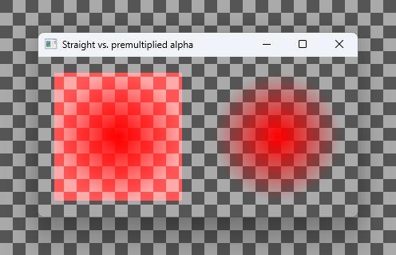

The straight one is red all the way into the corners of its square, where alpha is 0. In real content you see this as bright fringes around soft edges and halos around anti-aliased text. This applies to everything on this page: GDI DIBs, DXGI and Vulkan swapchains, OpenGL.

## GPU content (DXGI)

So far everything was drawn with GDI. A Direct3D program gets its frames to the screen through a DXGI swapchain, and there are three kinds of those, which deal with the redirection surface very differently. `12_dxgi_present` clears a D3D11 swapchain to transparent, with a 50% red square in the middle (premultiplied, with `ClearView`), and presents it in each of these ways. The window setup is the one from `05`, black brush and blur-behind, unless an option changes it.

### Composition swapchain

`CreateSwapChainForComposition` with `DXGI_ALPHA_MODE_PREMULTIPLIED`, set as the content of a DirectComposition visual, with the target on top of the window (`CreateTargetForHwnd(hwnd, TRUE, ...)`). This is the way to get per-pixel alpha from Direct3D. The visual is composed on top of the redirection surface, though, so the surface still has to be transparent:

| `--composition` | `--null-brush` | `--no-blur` | `--no-redirection-bitmap` |
|---|---|---|---|
|  | 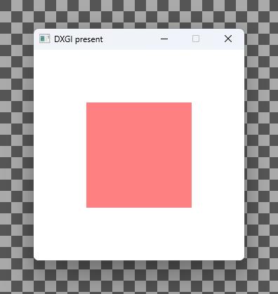 |  |  |

With the black brush and blur-behind it's exact (170,43,43 over the dark squares). With a NULL brush the surface stays opaque white as in `09`, and the content is blended over white (255,128,128). That's what the reports about a white or black background behind otherwise correct translucent content look like. Without blur-behind the surface is opaque black, again with the content blended over it. With `WS_EX_NOREDIRECTIONBITMAP` there is no surface and the visual is all there is, so that's exact even with a NULL brush and no blur-behind (`--no-redirection-bitmap --null-brush --no-blur`, not shown, looks the same).

### Flip-model HWND swapchain

`CreateSwapChainForHwnd` with `DXGI_SWAP_EFFECT_FLIP_DISCARD` is what most Direct3D programs use. DXGI refuses `DXGI_ALPHA_MODE_PREMULTIPLIED` for it (`DXGI_ERROR_INVALID_CALL`), and DWM ignores the alpha of what you present, with or without blur-behind. It also presents fine with `WS_EX_NOREDIRECTIONBITMAP`, still opaque.

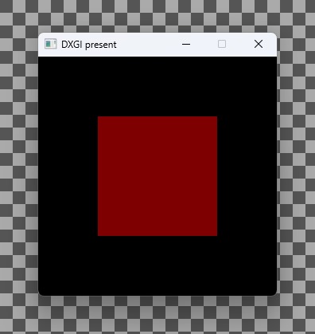

### Bitblt-model HWND swapchain

The older `DXGI_SWAP_EFFECT_DISCARD` copies every frame into the redirection surface, alpha included. So with blur-behind it's transparent, just like GDI content, and without blur-behind it's opaque. DXGI refuses the premultiplied alpha mode here too, but the alpha byte gets copied anyway. Microsoft recommends the flip model these days, and Windows 11 can even switch bitblt-model swapchains to flip model on its own ("Optimizations for windowed games" in the graphics settings). With that turned on for `12_dxgi_present.exe` nothing changed here, but I wouldn't build on this.

| `--blit` | `--blit --no-blur` | `--blit --no-redirection-bitmap` |
|---|---|---|
|  |  | 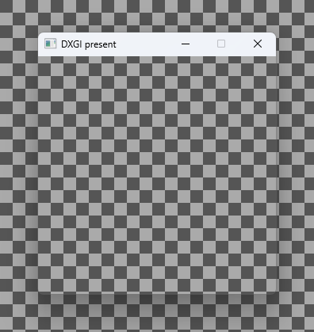 |

With `WS_EX_NOREDIRECTIONBITMAP` there's nothing to copy into, and the client area shows nothing at all.

### Why not WS_EX_NOREDIRECTIONBITMAP

The [documentation](https://learn.microsoft.com/en-us/windows/win32/winmsg/extended-window-styles) says it's for windows that "use mechanisms other than surfaces to provide their visual", and you find it in DirectComposition examples, since without a surface there's nothing to clear. That's fine as long as all content of the window comes from your own visuals. It's a problem when you don't control how the window's content is presented, for example with Vulkan or OpenGL, or anything a library or driver presents for you. A present path that copies into the redirection surface (the bitblt model above is one, and drivers can have their own fallback paths like that) then shows nothing. Keeping the surface and clearing it to zero works with all of them.

## Vulkan

`13_vulkan_perpixel_alpha` uses the window setup from `05` (black brush and blur-behind) and a Vulkan swapchain with `VK_COMPOSITE_ALPHA_PRE_MULTIPLIED_BIT_KHR`. It shows a radial gradient, opaque red in the middle and transparent at the corners, premultiplied.

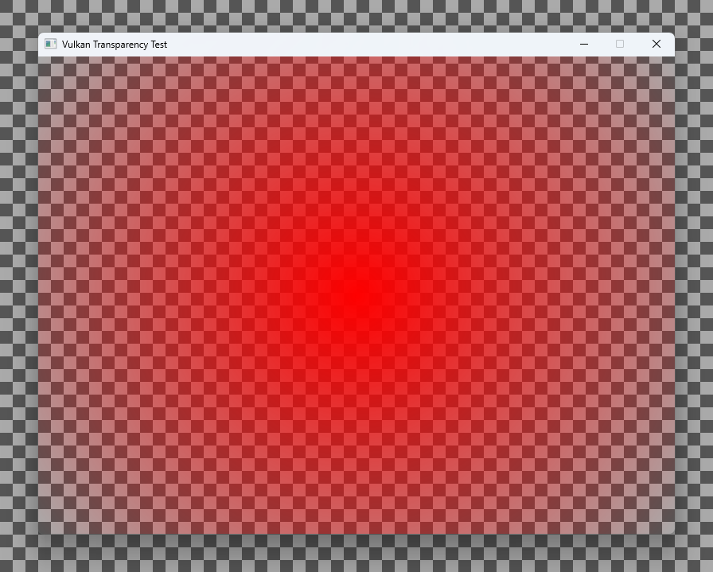

Vulkan doesn't say how a swapchain gets to the screen, and on Windows drivers differ. Check `VkSurfaceCapabilitiesKHR::supportedCompositeAlpha`: if it only has `VK_COMPOSITE_ALPHA_OPAQUE_BIT_KHR`, that driver won't give you transparency. The capabilities are per GPU, so with two of them check both: `13` takes the first one that offers premultiplied for its window. NVIDIA's driver offers it in recent versions, 610.47 here. For other drivers, [gpuinfo.org](https://vulkan.gpuinfo.org/) has the surface capabilities that people reported.

## OpenGL

WGL has no way to say "this window should be transparent". You choose a pixel format with alpha bits, and the rest is up to the window setup and the driver. `14_opengl_perpixel_alpha` has the window setup from `05` (black brush and blur-behind), plus `CS_OWNDC` as OpenGL programs usually have it, and clears to transparent with a 50% red square (premultiplied, with a scissored `glClear`).

What makes OpenGL tricky is that drivers can present it in different ways. One is the traditional way, which here behaves like GDI content: transparent with blur-behind. But drivers can also present OpenGL (and Vulkan) through a DXGI swapchain, for things like Auto HDR and lower latency in borderless windows. Then the driver has to pick flip or bitblt for that swapchain, and from the [DXGI section](#gpu-content-dxgi) you know what flip does with alpha.

In NVIDIA's driver this is the "Vulkan/OpenGL present method" setting in the NVIDIA control panel (since driver 526.47). The default is "Auto", and "Prefer layered on DXGI Swapchain" forces DXGI. With the default:

| default | `--layered` | `--no-blur` |
|---|---|---|
|  | 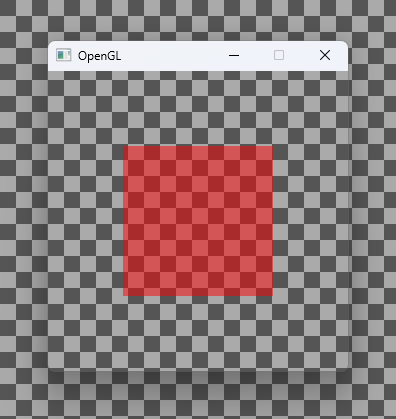 |  |

With "Prefer layered on DXGI Swapchain":

| default | `--layered` | `--layered --no-own-dc` | `--layered --no-blur` |
|---|---|---|---|
|  |  |  | 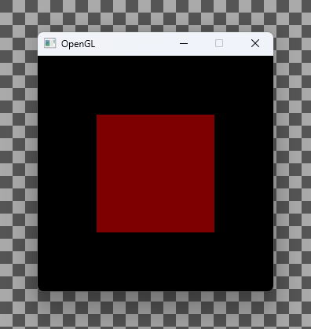 |

With the default setting blur-behind is enough, and the layered style changes nothing. Through DXGI the same program is opaque (black, 127,0,0 in the square), and only `--layered` makes it transparent again. As far as I can tell, the driver doesn't look at blur-behind when it picks the swapchain type, but it does look at the layered style. Without blur-behind it's opaque either way. So for OpenGL you want both, and the layered style doesn't hurt on the other path. The Vulkan demo looks exactly the same with both settings, and so does GLFW's white window.

AMD's driver seems to have the same mechanism. According to [PCGamingWiki](https://www.pcgamingwiki.com/wiki/Glossary:High_dynamic_range_(HDR)), it presents OpenGL and Vulkan through DXGI when Windows HDR is on (since Adrenalin 23.7.1), and OpenGL also when "OpenGL Triple Buffering" is enabled. GLFW issue [#2731](https://github.com/glfw/glfw/issues/2731), transparency broken with AMD triple buffering, fits that.

The [`WS_EX_LAYERED` documentation](https://learn.microsoft.com/en-us/windows/win32/winmsg/extended-window-styles) says the style "cannot be used if the window has a class style of either CS_OWNDC or CS_CLASSDC". OpenGL windows often have `CS_OWNDC` (GLFW's do), and here the combination just works: `CreateWindowEx` and `SetLayeredWindowAttributes` succeed, and the result with and without `CS_OWNDC` is the same. I don't know what that restriction is about, maybe it's from before Windows 8. Two more things about the layered style: a layered window isn't shown at all until you call `SetLayeredWindowAttributes` or `UpdateLayeredWindow`, and in the [#2681](https://github.com/glfw/glfw/pull/2681) discussion GLFW's maintainers found that on Windows 7 the window became invisible, so if you still support Windows 7, only set it on 8 and later.

## When it doesn't work

| What you see | Likely cause |
|---|---|
| Opaque black where it should be transparent | No opt-in (rule 1), a flip-model HWND swapchain, OpenGL through DXGI without `WS_EX_LAYERED`, or a Vulkan driver without premultiplied composite alpha |
| Opaque white, or another opaque color, behind otherwise correct translucent content | The surface was never cleared: a NULL brush and nothing paints (GLFW does that), or a black class brush that never gets used because the window procedure handles `WM_ERASEBKGND` |
| A lighter version of the background where the window should be clear | A background brush that isn't black, it gets added to the background |
| Correct, but the background behind the window is darker than outside it | NULL or empty blur region |
| The frame color behind your content | `DwmExtendFrameIntoClientArea` instead of blur-behind |
| Colors too bright, fringes around soft edges | Straight alpha instead of premultiplied |
| Nothing at all in the client area | `WS_EX_NOREDIRECTIONBITMAP` with a present path that copies into the surface |
| Works in a borderless test window, not in a normal one | Nothing clears the surface. A `WS_POPUP` window that never paints isn't drawn at all, so it looks transparent |

## Microsoft documentation

Where the docs help and where they mislead, collected from the sections above:

* [Custom Window Frame Using DWM](https://learn.microsoft.com/en-us/windows/win32/dwm/customframe): right about the black brush clearing all four channels. Its remark that the default `COLOR_WINDOW + 1` background doesn't have alpha 0 is wrong at the byte level, see [GDI](#gdi). The page is about extending the frame, not about transparency.
* [`DwmEnableBlurBehindWindow`](https://learn.microsoft.com/en-us/windows/win32/api/dwmapi/nf-dwmapi-dwmenableblurbehindwindow) and [`DWM_BLURBEHIND`](https://learn.microsoft.com/en-us/windows/win32/api/dwmapi/ns-dwmapi-dwm_blurbehind): documented as a blur effect. Today it's how you opt in to per-pixel alpha, and with a NULL or empty region you get a darkening layer instead of a blur, see [the opt-in](#the-redirection-surface-and-the-dwm-opt-in).
* [`DwmExtendFrameIntoClientArea`](https://learn.microsoft.com/en-us/windows/win32/api/dwmapi/nf-dwmapi-dwmextendframeintoclientarea): accurate ("a solid surface"), just not a transparency recipe anymore.
* [Extended Window Styles](https://learn.microsoft.com/en-us/windows/win32/winmsg/extended-window-styles): the `CS_OWNDC` restriction of `WS_EX_LAYERED` doesn't seem to apply on Windows 11, see [OpenGL](#opengl). The description of `WS_EX_NOREDIRECTIONBITMAP` is correct, but see [why not](#why-not-ws_ex_noredirectionbitmap).

<details>
<summary>Keywords</summary>

Windows transparent window, Win32 per-pixel alpha, transparent client area, DWM blur behind, `DwmEnableBlurBehindWindow`, `DWM_BLURBEHIND`, `DwmExtendFrameIntoClientArea`, `CreateRectRgn`, redirection surface, `BLACK_BRUSH`, `hbrBackground`, `WM_ERASEBKGND`, GDI alpha channel, `WS_EX_LAYERED`, `SetLayeredWindowAttributes`, `CS_OWNDC`, `WS_EX_NOREDIRECTIONBITMAP`, layered window, premultiplied alpha, straight alpha, DirectComposition, `CreateSwapChainForComposition`, `DXGI_ALPHA_MODE_PREMULTIPLIED`, flip model, bitblt model, Vulkan transparent swapchain, `VK_COMPOSITE_ALPHA_PRE_MULTIPLIED_BIT_KHR`, `supportedCompositeAlpha`, OpenGL transparent window, WGL alpha, Vulkan/OpenGL present method, layered on DXGI swapchain, GLFW `GLFW_TRANSPARENT_FRAMEBUFFER`, Windows 10, Windows 11, Mica, Acrylic, `DWMWA_SYSTEMBACKDROP_TYPE`.

</details>
